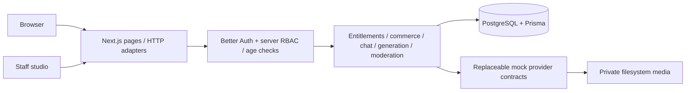

# Architecture decisions

VELORA is a single Next.js App Router deployment backed by PostgreSQL through Prisma 7's official JavaScript PostgreSQL adapter. It uses no native Prisma query engine. Redis is provisioned as a future shared-cache/queue destination; the current application does not pretend to use it. Existing checkouts are reused; no Git worktree is needed in isolated cloud tasks.

## Access

Roles are derived from database user records, never request fields. USER accesses only own purchases/conversations/settings. CREATOR_MANAGER manages the proprietary internal creator catalog, posts, requests and paid delivery. MODERATOR reviews generated outputs and reports, and can hide/remove content or suspend reported users. ADMIN manages accounts, configuration, payments and audit. External managers scoped to specific creators need additional tenancy rules before external onboarding.

Every account must be active and carry SELF_DECLARED or VERIFIED age state for member operations. Public preview media separately requires a signed self-declaration cookie. VERIFIED is reserved for a future trusted verifier; self-declaration cannot overwrite VERIFIED or reverse REJECTED. Country restrictions rely on an explicitly trusted edge header and fail closed when configured without evidence.

## Commerce

Checkout resolves a published target and server price, serializes initiation per user, and persists a pending intent. A provider settlement is reconciled with amount/currency/reference checks in a transaction guarded by a payment advisory lock. A unique provider event protects duplicate callbacks. Grants, journal entries, confirmation notification and revenue event are atomic. PPV does not come with membership. Cancellation preserves the period; refund revokes grants and writes inverse journal entries. The payment-provider contract must enforce native idempotency for future network retries.

## Chat

Input moderation → owned conversation → persona → recent history (12 messages) → opted-in short-term memory → subscription context → provider deadline → output moderation → persistence → token usage → notifications. Only the safe message view crosses the API boundary. Locked message bodies/attachments are withheld until their purchase is PAID, including export. No chat text is sent to analytics. Transaction/usage/signup records are essential operational events; optional page-view/favorite analytics require consent. Discovery combines deterministic personality/language/popularity scores with subscriptions, purchases, recent consented views and chat engagement. Account memory off clears saved memory; conversation deletion deletes messages and memory while preserving financial journals.

## Content

QUEUED → PROCESSING → MODERATION → REVIEW → APPROVED/REJECTED (or FAILED). Safe mock image/voice assets are private immediately. REVIEW has no publication side effect. A staff approval copies the asset reference into the media library; a separate post operation requires a reviewed asset belonging to the selected creator and creates an audit record. Scheduled visibility is checked at request time. Generated prompts, operator identities and provider metadata are staff-only.

## Storage

Public portrait placeholders are explicitly public editorial illustrations. All post/message media is stored outside `public`. The protected delivery endpoint checks current moderation, deletion, creator availability, age and entitlement on each request. It is no-store and MIME-specific. The private filesystem provider rejects traversal and uses opaque keys. External upload validation rejects arbitrary SVG/HTML and checks allowed signatures, size and safe filenames; trusted internal SVG generation is intentionally separate. Replace with an S3-compatible adapter and authorized short-lived delivery when scaling.

## Reproducibility

Committed SQL migrations, lockfile, seed, `.env.example`, Dockerfile and Compose define the setup. Seed is idempotent and preserves existing database edits. Secrets and private generated outputs are ignored. Docker named volumes need an independent backup strategy; an onboarding snapshot is not a database-backup guarantee. Live server/container processes must restart in future tasks.
